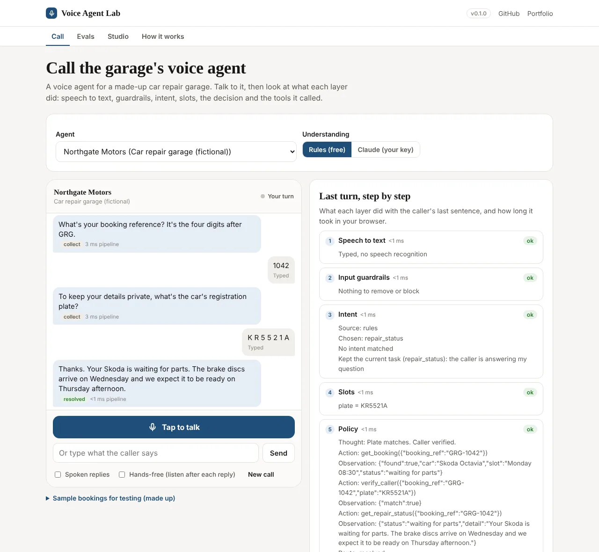

# Garage Voice Agent

**A voice AI agent for a car repair garage, built as a small platform: speech in and out, intent detection, routing, guardrails, tool calls, evals with a release gate, and agents defined as config.**

**Current version:** 0.1.0 ([changelog](CHANGELOG.md))

Live: https://kostasxeras.com/Garage-voice-agent/



## The question

Voice agents for customer calls look easy in a demo and fail in quiet ways in production. Speech recognition mishears words, a caller asks something the flow did not expect, or a model gives a confident answer it should never give, such as "yes, it's safe to drive". I wanted to build one end to end and answer three questions a platform PM has to answer:

1. Which parts should a model do, and which parts must stay as rules that can be tested?
2. What do you measure before an agent is allowed to go live, and what blocks a release?
3. What does a new agent need to define, and what should it inherit from the platform?

The business is a made-up garage, Northgate Motors. A garage call has the same parts as calls in more regulated industries: identity checks before sharing details, prices that must not sound like promises, and situations where the only right answer is to hand off to a person.

## Who it is for

- Hiring managers who want to see how I think about an AI agent platform, not only a single bot
- PMs who want a working example of evals and guardrails for a voice agent
- Me, as a test bed to compare rules with a language model on the same test calls

## What is inside

- **Call tab.** Talk to the agent with your microphone, or type. Replies are spoken. Beside the call, every layer shows what it did with your last sentence and how long it took: speech to text, input guardrails, intent, slots, policy with each tool call, output guardrails and text to speech.
- **Two ways to understand the caller.** Free rules, or Claude with your own API key. With Claude on, it can also word the replies. The rules still decide what happens.
- **Evals tab.** 70 scripted test calls (40 dev, 30 holdout) scored per layer: intent, slots, final outcome, safety recall, containment and handoffs nobody needed. Simulated speech errors at three levels. A release gate that fails if any safety call is missed or any guardrail test fails. A table of runs to compare rules, Claude and noise levels.
- **Guardrail tests.** 12 bad and good replies fed straight into the output guardrails.
- **Studio tab.** Agents are config files on a shared platform. Create a new agent (a tyre shop template), validate it, and deploy it only if it passes the platform's safety tests and its own tests. The time from opening the template to deploying is measured.

## Data and sources

No real data. The garage, the tyre shop, prices, opening hours and bookings are made up. The test calls are synthetic and I wrote them. Speech recognition and voices come from your browser. Claude calls use your own key and go straight from your browser to Anthropic.

## Headline numbers

Rules engine, measured on 22 November 2026 with `node scripts/noise-sweep.cjs`. Noisy runs are the mean of 10 random seeds. Full output: [docs/eval-results.md](docs/eval-results.md).

| Holdout set (30 calls) | No speech errors | About 6% of words wrong | About 10% | About 16% |
|---|---|---|---|---|
| Calls fully passed | 100% | 81.3% | 71.3% | 60.0% |
| Safety calls handed to a mechanic | 100% | 97.5% | 92.5% | 92.5% |
| Contained (agent finished the task alone) | 100% | 70.7% | 56.0% | 44.0% |

The 100% column is an upper bound, not a result. I wrote the holdout calls before the rules (the git history shows the order), but I knew them when I wrote the rules. The noisy columns are the useful ones. They show where rules break once speech recognition makes mistakes.

Claude vs rules on the same calls: [not measured yet, run the Evals tab with a key and add the numbers here].

## Decisions

- [The model understands, the rules decide](docs/decisions/0001-model-understands-rules-decide.md)
- [Safety rules always win over the model](docs/decisions/0002-safety-rules-win.md)
- [Free browser speech for v0.1](docs/decisions/0003-browser-speech.md)
- [Agents are config, gated by tests](docs/decisions/0004-agents-as-config.md)
- [A holdout set and many seeds for noisy evals](docs/decisions/0005-holdout-and-seeds.md)

## How I would measure the platform

These are the metrics I would track for a real deployment. No real usage yet, so the targets are placeholders.

| Metric | Definition | Target |
|---|---|---|
| Containment | Calls the agent finishes without a person, of calls it should handle | [target] |
| Safety recall | Safety calls handed to a person, measured on the eval set and on sampled real calls | 100% (release gate) |
| Unneeded handoffs | Calls a person took that the agent should have handled | [target] |
| Turn latency, p95 | End of caller speech to start of the agent's voice | [target] |
| Uptime | Share of minutes the line answers | [target] |
| Time to deploy a new agent | From starting a config to passing the gate and going live | [target] |
| Delivery effort per client | Engineering hours to launch one new client agent | [target] |

## What I would do next

1. Run the holdout set with Claude Haiku and Sonnet and publish rules vs model, with and without speech errors
2. Ask a confirm question when a partial safety cue is heard ("Is there smoke, or a problem with the brakes, right now?") and measure if it closes the safety gap under noise
3. Get [number] test calls written by someone who has not seen the rules, to get a fair holdout
4. Add real phone audio (a SIP or WebRTC provider) and measure latency on a real line
5. Move from page storage to a shared config store, so deployed agents are not tied to one browser

See also [the platform roadmap](docs/platform-roadmap.md).

## How it was built

I framed the problem, chose the scope, made the product calls and wrote the conclusions. Claude (Anthropic) was my engineering partner for the code.

## Run it yourself

One HTML page and plain JavaScript, no build step. Open `index.html` through any local web server, for example `python3 -m http.server`, then go to http://localhost:8000. Use Chrome, Edge or Safari for speech recognition.

Run the evals without a browser: `node scripts/run-evals.cjs all` and `node scripts/noise-sweep.cjs`.

## Repo layout

```
index.html                 The page
app.css                    Shared base styles
js/engine.js               The platform: guardrails, intent, slots, policy, tools, trace
js/agents.js               Agent configs: the garage, the tyre shop template, platform tests
js/evalset.js              Test calls (dev and holdout) and guardrail tests
js/evals.js                Eval runner, speech error simulation, scoring
js/llm.js                  Optional Claude layer (understanding and wording)
js/ui.js                   Speech in and out, the call, evals and studio screens
scripts/                   Node scripts to run the evals
docs/product-brief.md      Problem, users, goals, scope
docs/case-study.md         Approach, findings, what I got wrong, next steps
docs/platform-roadmap.md   Ranked requests for the platform
docs/eval-results.md       Raw eval output
docs/decisions/            One record per real trade-off
docs/screenshots/          Desktop and mobile
```
